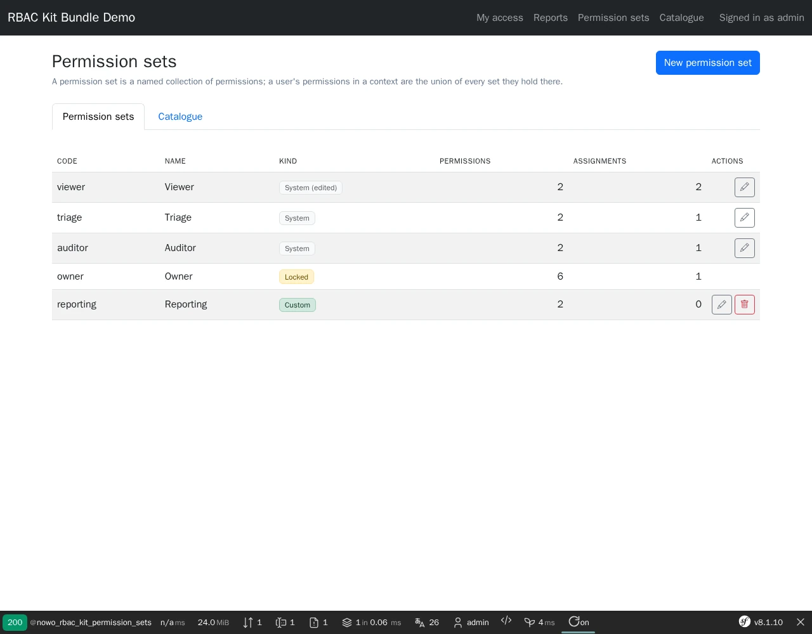
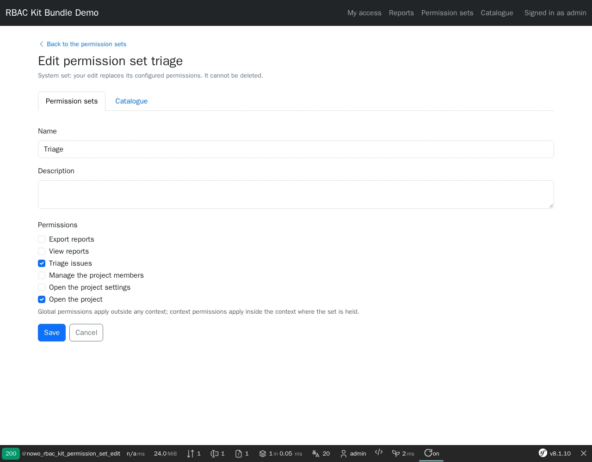
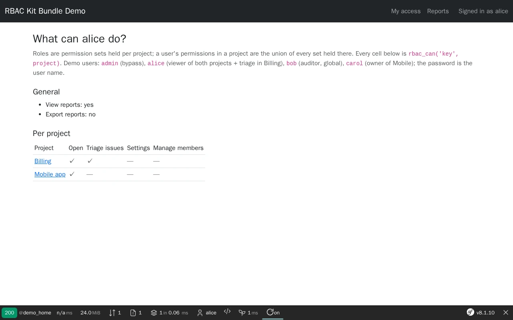

# RBAC Kit Bundle

[](https://github.com/nowo-tech/RbacKitBundle/actions/workflows/ci.yml) [](https://packagist.org/packages/nowo-tech/rbac-kit-bundle) [](https://packagist.org/packages/nowo-tech/rbac-kit-bundle) [](LICENSE) [](https://php.net) [](https://symfony.com) [](https://github.com/nowo-tech/RbacKitBundle) [](#tests-and-coverage)

> ⭐ **Found this useful?** [Install from Packagist](https://packagist.org/packages/nowo-tech/rbac-kit-bundle) · Give it a **star** on [GitHub](https://github.com/nowo-tech/RbacKitBundle) so more developers can find it.

**Role-based access control for Symfony where roles are permission sets.** Catalogue every permission a page, a page
resource or a menu link can ask for; define roles as sets of those permissions (two roles need not be comparable);
let users hold sets globally or **per context** (a project, a tenant, an organisation); ask
`isGranted('permission:<key>', $context)` or `rbac_can('<key>', context)` everywhere. A memoised, worker-safe voter
answers with the **union** of the sets the user holds in that context, a request guard refuses catalogued routes before
their controller, a coverage command proves every route is guarded, and a UiKit admin UI edits the sets. Fail closed:
an empty catalogue denies everything.

> 📋 **Compatible with Symfony 7.4, 8.0 and 8.1** · PHP 8.2+ (Symfony 8.x requires PHP 8.4+) · UiKit ^2.21 · FormKit ^2.17


This bundle is **FrankenPHP worker mode friendly**: every memo (catalogue, sets, grants, decisions) implements
`ResetInterface` and is cleared between requests.

## Screenshots

<table>
  <tr>
    <td align="center" width="33%">
      
      <br /><sub>Permission sets — system, edited, locked and custom</sub>
    </td>
    <td align="center" width="33%">
      
      <br /><sub>A set is a collection of catalogued permissions</sub>
    </td>
    <td align="center" width="33%">
      
      <br /><sub>rbac_can() per project: the union of the sets held there</sub>
    </td>
  </tr>
</table>

## Features

- **Permission catalogue** from the bundle configuration and tagged `PermissionProviderInterface` services: key, scope
  (`global` / `context`), guarded routes, group, labels; area aliases; validated (no redefinition, no route guarded
  twice, bounded size).
- **Permission sets (roles)** from the configuration (system sets, `all` (context keys) / `except` /
  `include_global`, `locked`) and, with
  `storage.type: doctrine`, editable and custom sets stored in one table; unknown keys grant nothing.
- **Typed contexts**: any object implementing `RbacContextInterface` (or your `ContextResolverInterface`) is a context
  identified by `<type>:<id>` (`project:5` ≠ `organization:5`); your `GrantProviderInterface` lists the sets each user
  holds (one call per user and request). A set held in a context never grants a platform-wide key unless the key opts
  in (`aggregate: true`).
- **Memoised voter** `permission:<key>` / `permission_route:<route>`: deny-first gates, optional bypass roles with
  vetoes ("view as member"), `role_grants`, per-key aggregation over the user's contexts, an optional fallback set for
  users without any assignment; worker-safe (`ResetInterface`), bounded memos.
- **Checks everywhere**: `PermissionChecker` (`can`, `canRoute`, `canArea`, `filter`), Twig `rbac_can()`,
  `rbac_can_route()`, `rbac_can_area()`, and an optional **DashboardMenu** permission checker.
- **Request guard** (opt-in): 403 (or the login entry point for guests) before the controller on a catalogued route
  without its permission; strangers to the context are refused by default.
- **Coverage**: `nowo:rbac:check` and `PermissionCoverage` fail when a route under your prefixes has no permission, a
  catalogue route does not exist or a set names an uncatalogued key.
- **Admin UI** (opt-in): permission sets and catalogue on the UiKit page contract, FormKit forms, CSRF bound to action
  and set, audit events (`PermissionSetChangedEvent`) after every mutation, 7 locales.

## Installation

```bash
composer require nowo-tech/rbac-kit-bundle
```

With Symfony Flex the recipe registers the bundle and adds `config/packages/nowo_rbac_kit.yaml` (safe defaults: an
empty catalogue denies everything) and `config/routes/nowo_rbac_kit.yaml` (the opt-in admin routes). Without Flex, see
[docs/INSTALLATION.md](docs/INSTALLATION.md).

## Quick start

```yaml
# config/packages/nowo_rbac_kit.yaml
nowo_rbac_kit:
    catalogue:
        permissions:
            reports.view: { scope: global, routes: [app_reports], aggregate: true }   # general page over my projects
            project.view: { scope: context, routes: [app_project_show] }
            project.issues.triage: { scope: context }
    permission_sets:
        viewer: { permissions: [reports.view, project.view] }
        triage: { permissions: [project.view, project.issues.triage] }
        owner: { all: true, locked: true }                 # every *context* key, never a global one
    grant_provider: App\Security\MembershipGrantProvider   # yields Assignment::in('owner', 'project', $id)
```

```php
// App\Entity\Project implements Nowo\RbacKitBundle\Context\RbacContextInterface
// (getRbacContextType(): 'project', getRbacContextId(): (string) $this->id)
$this->denyAccessUnlessGranted('permission:project.issues.triage', $project);
```

```twig
<button>Triage</button>
```

## Requirements

- PHP 8.2+ (8.4+ with Symfony 8), Symfony 7.4 / 8.0 / 8.1, `symfony/security-bundle` in the application.
- UiKit ^2.21 and FormKit ^2.17 (installed with the bundle; used by the admin UI).
- Optional: Doctrine ORM (`storage.type: doctrine`), nowo-tech/dashboard-menu-bundle (menu checker).

## Configuration

Every key, its default and its validation: [docs/CONFIGURATION.md](docs/CONFIGURATION.md).

## Usage

The decision model, grant providers, contexts, gates, the request guard, coverage, the admin UI and template overrides:
[docs/USAGE.md](docs/USAGE.md). Both host kinds are supported: [Standard host](docs/USAGE.md#standard-host) (zero config)
and [DDD host](docs/USAGE.md#ddd-host) (framework-free ports only, opt-in).

## Demo

- `demo/symfony8` — Symfony **8.1** (FrankenPHP PHP **8.5**, worker mode) with MySQL; host port **8096** (bound to
  127.0.0.1). Two projects, four demo users (`admin`, `alice`, `bob`, `carol`; the password is the user name), the
  request guard and the admin UI on Doctrine storage.

Runtime mode is **`FRANKENPHP_MODE`** (`worker` default, or `classic`) — see [docs/DEMO-FRANKENPHP.md](docs/DEMO-FRANKENPHP.md).

```bash
make -C demo up-symfony8          # http://localhost:8096
make test-e2e                     # Playwright e2e against the running demo
make demo-screenshots             # refresh docs/images/demo/*.webp
make demo-smoke                   # boot, HTTP 200, down (REQ-TEST-011)
```

## Development

```bash
make up
make install
make test
make cs-check
make phpstan
make igor
make test-coverage-100
make release-check
```

## Documentation

- [Installation](docs/INSTALLATION.md)
- [Configuration](docs/CONFIGURATION.md)
- [Usage](docs/USAGE.md)
- [Contributing](docs/CONTRIBUTING.md)
- [Code of Conduct](CODE_OF_CONDUCT.md)
- [Changelog](docs/CHANGELOG.md)
- [Upgrading](docs/UPGRADING.md)
- [Release](docs/RELEASE.md)
- [Security](docs/SECURITY.md)
- [Engram](docs/ENGRAM.md)
- [Spec-driven development](docs/SPEC-DRIVEN-DEVELOPMENT.md)
- [GitHub Spec Kit](docs/SPEC-KIT.md)

### Additional documentation

- [Templates (UiKit page contract)](docs/TEMPLATES.md)
- [Architecture](docs/ARCHITECTURE.md)
- [PSR evaluation (REQ-CS-007)](docs/PSR.md)
- [Demo (FrankenPHP)](docs/DEMO-FRANKENPHP.md)
- [FrankenPHP worker audit (kernel not reset)](docs/FRANKENPHP-WORKER-AUDIT.md)
- [GitHub Actions CI requirements](docs/GITHUB_CI.md)

## Tests and coverage

- Tests: PHPUnit (PHP) — unit tests plus kernel integration tests (voter through Symfony Security, Twig functions,
  request guard, kernel.reset between requests, admin UI end to end with CSRF and Doctrine on SQLite, opt-in routes,
  invalid configuration, coverage command) and the UiKit page contract test; Playwright e2e on the demo
- PHP: 100% (1230/1230 statements, 1420/1420 elements; gate enforced in CI by `composer test-coverage-100`, no exclusions)
- TS/JS: N/A
- Python: N/A

## License and author

MIT · [Nowo.tech](https://nowo.tech) · [Héctor Franco Aceituno](https://github.com/HecFranco)
