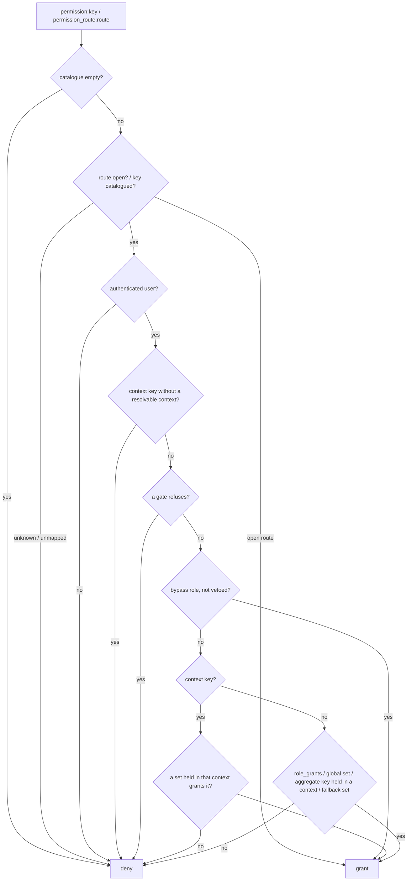

# Usage

## Table of contents

- [Model](#model)
- [Asking a permission](#asking-a-permission)
- [Decision order](#decision-order)
- [Contexts](#contexts)
- [Grant provider](#grant-provider)
- [Permission providers](#permission-providers)
- [Gates and bypass vetoes](#gates-and-bypass-vetoes)
- [General pages that aggregate contexts](#general-pages-that-aggregate-contexts)
- [Request guard](#request-guard)
- [Menus (DashboardMenu)](#menus-dashboardmenu)
- [Coverage check](#coverage-check)
- [Admin UI](#admin-ui)
- [Audit events](#audit-events)
- [Standard Symfony and DDD / hexagonal hosts](#standard-symfony-and-ddd--hexagonal-hosts)
- [Overriding templates](#overriding-templates)
  - [Override vs upgrade](#override-vs-upgrade)
  - [Procedure](#procedure)
  - [Overridable templates](#overridable-templates)
  - [Recovering upstream after a freeze](#recovering-upstream-after-a-freeze)
- [Forms](#forms)
- [Translations](#translations)
- [FrankenPHP worker mode](#frankenphp-worker-mode)

## Model

- **Permission**: a catalogued key (`project.issues.triage`) with a scope — `global` (outside any context) or `context`
  (inside one context: a project, a tenant…) — and the routes it guards.
- **Permission set** ("role"): a named collection of keys. Two sets need not be comparable; nothing compares roles by
  level.
- **Assignment**: a user holds a set in one context (a typed id such as `project:5`), or globally. A user's permissions
  in a context are the **union** of the sets they hold there (direct membership, group links…). A set held in a context
  never grants a global key, except keys flagged `aggregate`.

## Asking a permission

```php
// Controller / service (Symfony Security)
$this->denyAccessUnlessGranted('permission:project.settings.view', $project);
$security->isGranted('permission:reports.export');
$security->isGranted('permission_route:app_reports');          // the route's catalogued key

// PermissionChecker (fails closed: a context key without a context is refused before the voter)
$checker->can('project.issues.triage', $project);
$checker->canRoute('app_reports');
$checker->canArea('product.summary');                          // catalogue.aliases
$visible = $checker->filter($projects, 'reports.view');        // contexts that grant the key, in their order
```

```twig
…
<a href="{{ path('app_reports') }}">Reports</a>
…
```

## Decision order



Every decision is memoised per request for (user, roles, key, the subject's typed context id, bypass veto state) and
forgotten between requests; a subject that is not a context is never memoised.

## Contexts

Make the objects permissions are evaluated in implement `RbacContextInterface`:

```php
final class Project implements RbacContextInterface
{
    public function getRbacContextType(): string
    {
        return 'project';                 // stable alias, never a class name
    }

    public function getRbacContextId(): string
    {
        return (string) $this->id;
    }
}

final class Organization implements RbacContextInterface
{
    public function getRbacContextType(): string
    {
        return 'organization';            // Organization#5 and Project#5 are two contexts
    }

    public function getRbacContextId(): string
    {
        return (string) $this->id;
    }
}
```

The voter compares typed ids (`project:5`, `organization:5`), so integer ids may collide across classes without
sharing grants. When you cannot change the class, implement `ContextResolverInterface` (return
`ContextId::of('project', (string) $subject->getId())`) and set `context_resolver`.

## Grant provider

```php
final class MembershipGrantProvider implements GrantProviderInterface
{
    public function __construct(private MembershipRepository $memberships) {}

    public function assignmentsOf(object $user): iterable
    {
        foreach ($this->memberships->activeRolesOf($user) as $row) {      // one query
            yield $row['project_id'] === null
                ? Assignment::global($row['role_code'])
                : Assignment::in($row['role_code'], 'project', (string) $row['project_id']);
        }
    }
}
```

Return only active memberships (a deactivated membership grants nothing). The resolver calls it once per user and
request and reads at most `voter.max_assignments` assignments.

## Permission providers

Modules can add keys without touching the bundle configuration:

```php
final class WikiPermissions implements PermissionProviderInterface
{
    public function permissions(): iterable
    {
        yield new Permission('wiki.view', PermissionScope::Global, ['wiki_index'], 'wiki');
        yield new Permission('project.wiki.edit', PermissionScope::Context, [], 'wiki');
    }
}
```

## Gates and bypass vetoes

`PermissionGateInterface` services are asked first, for everybody (bypass roles included) — for example "the paying
account's plan leaves this module out". `BypassVetoInterface` services suspend `voter.bypass_roles` for one decision —
for example an administrator previewing a project as a member. Both are autoconfigured. Gate answers are memoised per
request with the decision (user, roles, key, the subject's typed context id, veto state), so they must not depend on
mutable request state — call `PermissionVoter::reset()` if it changes; a subject that is not a context is never
memoised. Vetoes are asked on every decision of a bypass role, so a "view as member" switch toggled mid-request is
seen at once.

## General pages that aggregate contexts

Flag a global key `aggregate: true` in the catalogue to let it pass when at least one of the user's contexts grants it
(default `false`: a set held in a context never grants a global key):

```yaml
nowo_rbac_kit:
    catalogue:
        permissions:
            reports.view: { scope: global, routes: [app_reports], aggregate: true }
            reports.export: { scope: global }                # never promoted from a project-held set
```

Asked **without** a subject (`rbac_can('reports.view')`, the route guard, the menu) the key passes when any of the
user's contexts grants it. Asked **with** a context subject (`rbac_can('reports.view', project)`,
`isGranted('permission:reports.view', $project)`) it passes only when a set held in **that** context grants it (or the
user holds the key platform-wide: role grant, global assignment, fallback set, bypass). Show the data of the granting
contexts only:

```php
$projects = $checker->filter($projectRepository->ofUser($user), 'reports.view');   // only the granting projects
```

`filter()` and `rbac_can(key, subject)` take **context objects** (or objects your `context_resolver` maps to a
context). A subject that does not resolve to a typed context — a report row wrapping a project, a wrong type, a blank
id — grants nothing through aggregation (fail closed): pass the project itself, or unwrap such rows in a custom
`ContextResolverInterface`.

`voter.fallback_permission_set` lets users without any assignment keep the general pages (a new account), and
`role_grants` gives platform roles global keys.

## Request guard

With `request_guard.enabled` a main request to a catalogued route answers 403 before the controller when the key is not
granted (guests get the firewall's entry point). Implement `RequestContextResolverInterface` to give it the request's
context (memoise the lookup on the request attributes) and set `request_guard.context_resolver`; users holding no set
in the context, and requests whose context cannot be resolved, are refused. With `skip_strangers: true` those are left
to the controller (404 existence mask); a route with the default `_rbac_guard: false` is always left to its controller
(share links). Controllers keep `denyAccessUnlessGranted()` as a second layer.

## Menus (DashboardMenu)

With nowo-tech/dashboard-menu-bundle installed, `RbacMenuPermissionChecker` appears in the DashboardMenu "Permission
checker" list: an item with a route needs `permission_route:<route>`, an item with permission keys needs one of them
(`ROLE_*` keys are asked as roles). Unmapped routes are hidden unless they are in `catalogue.open_routes` (or
`unmapped_routes: allow`).

## Coverage check

```bash
php bin/console nowo:rbac:check --prefix=/dashboard --prefix=/projects
```

Or in a host test:

```php
$report = self::getContainer()->get(PermissionCoverage::class)->report(['/dashboard', '/projects']);
self::assertTrue($report->isClean(), implode("\n", $report->unguardedRoutes));
```

## Admin UI

`web_ui.enabled: true`, `storage.type: doctrine` (or your storage) and the route import:

```yaml
# config/routes/nowo_rbac_kit.yaml
nowo_rbac_kit:
    resource: .
    type: nowo_rbac_kit
```

Pages under `web_ui.path_prefix` (default `/admin/rbac`): **Permission sets** (code, name, kind, permissions,
assignments; new / edit / delete for managers), **Catalogue** (every key, its scope, routes and the sets holding it),
and the create / edit form (name, description, permissions as checkboxes). System sets are edited over their configured
default and never deleted; locked sets are read-only; a set in use (usage provider) cannot be deleted. Link it from your
menu with `path('nowo_rbac_kit_permission_sets')` (`RbacRoutes::PERMISSION_SETS`).

## Audit events

Every create, update and delete dispatches `PermissionSetChangedEvent` (action, code, context — name, permission count,
added / removed keys — and the user identifier `actorId`; `user`, the object, is deprecated):

```php
#[AsEventListener]
final class AuditPermissionSets
{
    public function __invoke(PermissionSetChangedEvent $event): void
    {
        // $this->audit->record('permission_set.' . $event->action, $event->actorId, $event->context + ['code' => $event->code]);
    }
}
```

## Standard Symfony and DDD / hexagonal hosts

Both paths are supported (1.1); the standard one is the zero-config default.

- **Standard host:** `RbacContextInterface` on your entities, `PermissionChecker` / `is_granted('permission:…')`, the
  admin UI on `storage.type: doctrine`. Edits are DBAL statements on your default manager's connection: they never
  flush it, so your own pending changes are not committed by an edit.
- **DDD / hexagonal host:** keep the domain free of the bundle: resolve contexts with a `ContextResolverInterface`
  (string ids, no interface on your entities), feed grants through `GrantProviderInterface`, depend on
  `PermissionCheckerInterface` / `PermissionSetManagerInterface`, audit with `actorId`, and keep the record off your
  domain manager:

  ```yaml
  doctrine:
      orm:
          default_entity_manager: default
          entity_managers:
              default: { connection: default, mappings: { App: { type: xml, dir: '%kernel.project_dir%/config/doctrine', prefix: 'App\\Domain' } } }
              rbac: { connection: default }   # same or another connection
  nowo_rbac_kit:
      storage: { type: doctrine }
      doctrine: { entity_manager: rbac }
  ```

  `PermissionSetRecord` is then mapped on `rbac` only (also off an `auto_mapping` default) and the bundle clears that
  manager at the end of every request, message and command; your managers are never flushed, cleared or reset.
  `storage.type: service` remains the fully custom path (your own `PermissionSetStorageInterface`).
- `BypassVetoInterface` and `RequestContextResolverInterface` take Symfony security / HTTP types on purpose: they are
  adapter-layer SPIs, not domain ports.

## Overriding templates

### Override vs upgrade

Prefer, in this order: `nowo_ui_kit` theme / layout (every bundle page follows), `web_ui.templates.<page>` with a thin
`` overriding one block, and only then a full-file override
under `templates/bundles/NowoRbacKitBundle/`. **An application file at the override path always wins and will not pick
up vendor changes for that path until you remove or merge it** (freeze rule).

### Procedure

1. Pick the `<subpath>` from the table below.
2. Create `templates/bundles/NowoRbacKitBundle/<subpath>` in the application (same relative path).
3. Clear the cache (`php bin/console cache:clear`).

The bundle registers the `@NowoRbacKitBundle` namespace with the application override directory first and its own
views last (`TwigPathsPass`), so the application file wins (REQ-TWIG-001 / REQ-TWIG-002).

### Overridable templates

| `<subpath>` | Purpose |
| --- | --- |
| `admin/index.html.twig` | Permission sets (UiKit list scaffold; kind badge cells) |
| `admin/catalogue.html.twig` | Catalogue (UiKit list scaffold; scope badge cells) |
| `admin/form.html.twig` | Create / edit a set (UiKit form scaffold; delete zone for custom sets) |
| `admin/_cells.html.twig` | Row cells (kind and scope badges, translated labels) |

### Recovering upstream after a freeze

Delete (or rename aside) the application override, clear the Twig cache, then re-apply only surgical changes
(`web_ui.templates` + one block). Diff against `vendor/nowo-tech/rbac-kit-bundle/src/Resources/views/` first.

## Forms

Every form is a Symfony Form Type rendered with `form_start` / child loop / `form_end` by the UiKit scaffolds
(REQ-TWIG-003 / REQ-TWIG-005): `PermissionSetType` (FormKit profile `rbac_kit`, POST + CSRF) and FormKit `CsrfOnlyType`
forms for the delete buttons (`ActionForms`: one form name and CSRF token id `nowo_rbac/<action>/<target>` per action
and set). Hosts overriding templates must not reintroduce raw `<form>` / `<input>` markup.

## Translations

UI copy: `NowoRbacKitBundle` domain (7 locales). Permission and system set labels: `catalogue.translation_domain`.

```yaml
# translations/messages.en.yaml
permission:
    project.issues.triage:
        label: 'Triage issues'
        description: 'Change status, assignee and priority'
permission_set:
    viewer:
        label: 'Viewer'
```

## FrankenPHP worker mode

`PermissionCatalog`, `PermissionSetRegistry`, `GrantResolver` and `PermissionVoter` memoise per request and implement
`ResetInterface` (`kernel.reset`): nothing about a user survives the request. Every other service is stateless. The
admin access guard trusts a token only when a firewall matched the current main request. Verified by PHPStan FrankenPHP
rulesets and Igor (see [FRANKENPHP-WORKER-AUDIT.md](FRANKENPHP-WORKER-AUDIT.md)).
